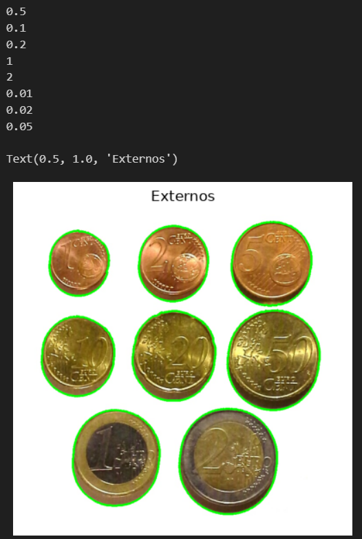

# Práctica 3

Este repositorio contiene el cuaderno `tareas_p3.ipynb`, con dos tareas: determinar en tiempo real, con la cámara, la cantidad de dinero que suman unas monedas y, como segunda tarea, un clasificador de plásticos. Sin el uso de modelos de aprendizaje profundo.

### 👥 Autores:
- [Enrique Sosa Ojeda](https://github.com/Enric1005)
- [Vidal de León Giménez](https://github.com/t3ntox)

------

## Archivos necesarios

- `Monedas2.jpg` — imagen ideal con monedas sobre fondo uniforme, utilizada en la tarea previa de la Tarea 1.
- `FRA.png` — imagen ideal para extraer características de los plásticos de tipo FRA.
- `PEL.png` — imagen ideal para extraer características de los plásticos de tipo PEL.
- `TAR.png` — imagen ideal para extraer características de los plásticos de tipo TAR.
- `MPs_test.png` — imagen para comprobar el funcionamiento del clasificador de plásticos.

## Tarea 1 — Contador de monedas

El objetivo de esta tarea es contar el dinero que suman las monedas visualizadas a través de la cámara. Como paso previo, se ha añadido una tarea en la que se detecta cada moneda de una imagen ideal junto con su valor correspondiente.

El cuaderno comienza con un bloque de imports (`cv2`, `numpy`, `matplotlib`, `math`) que hay que ejecutar antes del resto del código.

### Tarea previa — Imagen ideal

1. **Tabla de referencia:** el diccionario `monedas_euro` asocia cada valor de moneda con su **área** en mm² (calculada a partir de su diámetro real como π·(d/2)²). Por ejemplo, 1 céntimo ≈ 207,39 mm² y 2 € ≈ 520,77 mm².
2. **Segmentación:** se convierte la imagen a gris y se umbraliza con `cv2.threshold(img_gris, 0, 255, cv2.THRESH_BINARY_INV + cv2.THRESH_OTSU)`. Se usa la versión invertida porque las monedas son más oscuras que el fondo y OpenCV asume los objetos en blanco; Otsu elige el umbral automáticamente.
3. **Contornos:** `cv2.findContours(..., cv2.RETR_EXTERNAL, cv2.CHAIN_APPROX_SIMPLE)` obtiene solo los contornos externos, y se descartan los de área menor a 5 píxeles (ruido). El área de cada contorno se calcula con `cv2.contourArea`.
4. **Escala píxeles → mm²:** al no hacer clic manualmente sobre una moneda de referencia, se toma como referencia la **moneda más pequeña de la imagen**, que se asume de 1 céntimo: `escala = monedas_euro[0.01] / min(contornos)`.
5. **Clasificación:** el área de cada contorno se convierte a mm² (`c * escala`) y se asigna a la moneda cuya área de referencia contenga ese valor con una tolerancia de ±5,5 % (`0.945 * ref <= area <= 1.055 * ref`). Los valores detectados se imprimen por consola y los contornos se dibujan en verde sobre la imagen con `cv2.drawContours`.

En la imagen ideal se identifican correctamente las ocho denominaciones (1, 2, 5, 10, 20 y 50 céntimos, 1 € y 2 €).

### Resultados

### Tarea 1 — Demostrador en vivo con cámara

En vídeo la segmentación por umbralizado deja de ser fiable (cambios de iluminación, sombras, reflejos), así que se cambia de estrategia: se detectan círculos con la transformada de Hough, se siguen entre frames y se clasifican combinando **tamaño** y **color**.

Para que el demostrador funcione correctamente deben cumplirse ciertas condiciones; en caso contrario pueden producirse fallos:

- Debe haber una moneda de 1 céntimo en la escena, ya que es la referencia para calcular la escala.
- El fondo debe ser blanco.
- La cámara debe estar colocada a 90º respecto a las monedas y a una distancia relativamente corta.

**Constantes:**
- `MONEDAS`: diámetro real en mm de cada denominación.
- `COBRE = (0.01, 0.02, 0.05)` y `ORO = (0.10, 0.20, 0.50)`: grupos de monedas por aleación, que comparten color. `1 €` y `2 €` son bimetálicas y se tratan aparte.
- `TOL_H = 8` (tolerancia de tono para considerar dos monedas del mismo color), `TOL_S = 35` (contraste mínimo de saturación para detectar una moneda bimetálica) y `CORR_ESCALA = 1.08` (corrección empírica de la escala).

**Funciones:**
1. **`detecta_circulos(frame)`:** suaviza el frame en gris con `cv2.GaussianBlur((9, 9), 2)` y aplica `cv2.HoughCircles(cv2.HOUGH_GRADIENT, ...)` con `param1=80`, `param2=25` y radios entre 30 y 160 píxeles. Después elimina duplicados: si dos círculos están muy próximos (distancia menor al 90 % del mayor radio) se considera la misma moneda, quedándose con el de mayor radio cuando los centros casi coinciden.
2. **`actualiza_pistas(pistas, dets)`:** mantiene un seguimiento sencillo de cada moneda entre frames (pistas). Empareja detecciones con pistas ordenando por distancia, suaviza la posición (`0.5`) y estima el radio como la **mediana de los últimos 10 radios**, lo que estabiliza la medida. Las detecciones sin pista crean una nueva, y las pistas que llevan más de 8 frames sin detección se descartan.
3. **`tono(hsv, p)`:** mediana del canal H (tono) en la zona central de la moneda (60 % del radio). Sirve para distinguir cobre de oro.
4. **`contraste(hsv, p)`:** diferencia de saturación entre el centro (distancia < 0,5 del radio) y el anillo exterior (entre 0,78 y 0,92). Es alto en valor absoluto en las monedas bimetálicas, donde centro y anillo son de aleaciones distintas, y su signo distingue 1 € de 2 €.
5. **`es_cobre(p, ref)`:** compara el tono de la moneda con el de la referencia (que es de cobre), teniendo en cuenta que H es circular (`min(dh, 180 - dh)`).
6. **`diametro_mm(p, ref)`:** convierte el radio en píxeles a mm usando la referencia: `MONEDAS[0.01] * r / r_ref * CORR_ESCALA`.
7. **`clasifica(d_mm, candidatas)`:** elige, entre las candidatas, la moneda cuyo diámetro real tiene menor error relativo respecto al medido, y la acepta solo si el error es inferior al 10 %.
8. **`valor_moneda(p, ref)`:** decide el valor final. Si el contraste de saturación supera `TOL_S` se trata de una bimetálica (`1 €` si el contraste es negativo, `2 €` si es positivo). En caso contrario se decide el grupo (cobre u oro) por el tono y se clasifica por diámetro dentro de ese grupo.
9. **`etiqueta(v)`:** formatea el valor para mostrarlo (`"20c"`, `"1E"`, o `"?"` si no se pudo clasificar).

**Bucle principal:**
1. Se captura vídeo con `cv2.VideoCapture(1)` a 1280×720 y en cada frame se detectan círculos, se actualizan las pistas y se convierte el frame a HSV.
2. Solo se consideran **monedas activas** las pistas estables (`n >= 5` detecciones y como mucho 3 frames perdidos), lo que evita falsos positivos puntuales.
3. Se toma como **referencia** la moneda activa de menor radio, que se asume de 1 céntimo, de forma análoga a la tarea previa. Cualquier moneda con radio similar (`<= 1.07 * r_ref`) se etiqueta como 1 céntimo.
4. Tono y contraste se suavizan temporalmente (medias exponenciales de 0,9/0,1 y 0,8/0,2) para que la etiqueta no parpadee.
5. Cada moneda se dibuja con un círculo y su etiqueta (azul: referencia, verde: clasificada, rojo: no reconocida, y más tenue si se ha perdido momentáneamente). El total acumulado se muestra arriba a la izquierda (`Total: X.XX EUR`).
6. El bucle termina al pulsar `Esc`, liberando la cámara y cerrando las ventanas.

### Resultados

