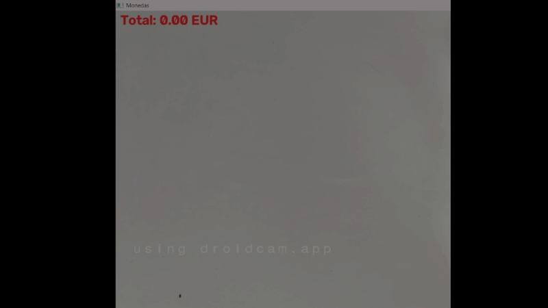
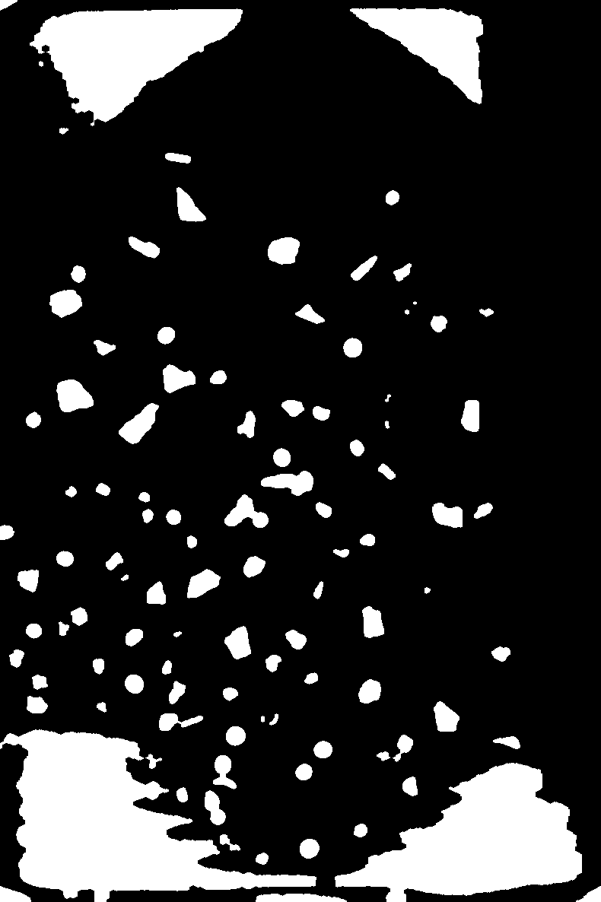
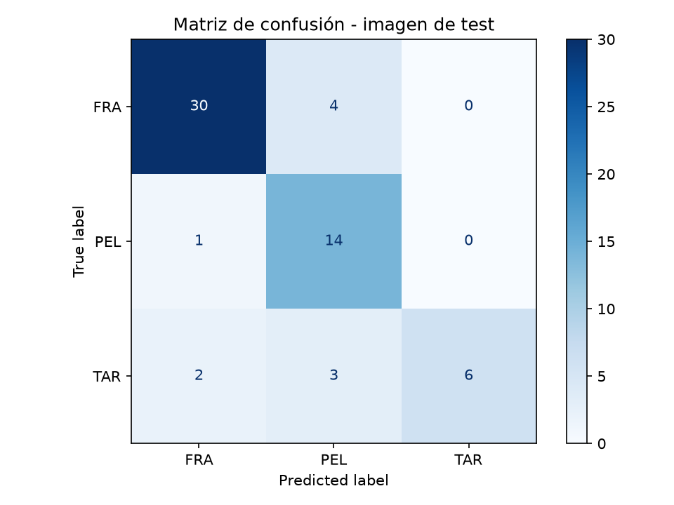
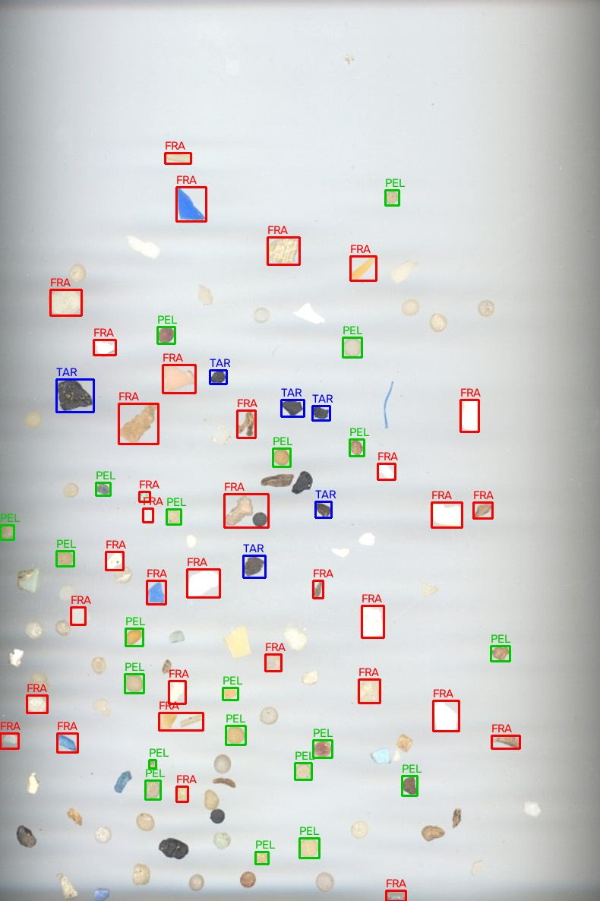

# Práctica 3

Este repositorio contiene el cuaderno `tareas_p3.ipynb`, con dos tareas: determinar en tiempo real, con la cámara, la cantidad de dinero que suman unas monedas y, como segunda tarea, un clasificador de plásticos. Sin el uso de modelos de aprendizaje profundo.

### 👥 Autores:
- [Enrique Sosa Ojeda](https://github.com/Enric1005)
- [Vidal de León Giménez](https://github.com/t3ntox)

------

## Archivos necesarios

- `[Monedas.jpg, Monedas1.jpg, Monedas2.jpg]` — imagenes ideales con monedas sobre fondo uniforme, utilizadas en la tarea previa de la Tarea 1.
- `[fragment-03-olympus-10-01-2020.jpg, FRA.png]` — imagenes ideales para extraer características de los plásticos de tipo FRA.
- `[pellet-03-olympus-10-01-2020.jpg, PEL.png]` — imagenes ideales para extraer características de los plásticos de tipo PEL.
- `[tar-03-olympus-10-01-2020.jpg, TAR.png]` — imagenes ideales para extraer características de los plásticos de tipo TAR.
- `MPs_test_bbs.csv` - cvs con las distintas bounding boxes anotadas con su respectivo label real para la imagen de test
- `MPs_test.png` — imagen para comprobar el funcionamiento del clasificador de plásticos.

## Tarea 1 — Contador de monedas

El objetivo de esta tarea es contar el dinero que suman las monedas visualizadas a través de la cámara. Como paso previo, se ha añadido una tarea en la que se detecta cada moneda de una imagen ideal junto con su valor correspondiente.

El cuaderno comienza con un bloque de imports (`cv2`, `numpy`, `matplotlib`, `math`) que hay que ejecutar antes del resto del código.

### Tarea previa — Imagen ideal

1. **Tabla de referencia:** el diccionario `monedas_euro` asocia cada valor de moneda con su **área** en mm² (calculada a partir de su diámetro real como π·(d/2)²). Por ejemplo, 1 céntimo ≈ 207,39 mm² y 2 € ≈ 520,77 mm².
2. **Segmentación:** se convierte la imagen a gris y se umbraliza con `cv2.threshold(img_gris, 0, 255, cv2.THRESH_BINARY_INV + cv2.THRESH_OTSU)`. Se usa la versión invertida porque las monedas son más oscuras que el fondo y OpenCV asume los objetos en blanco; Otsu elige el umbral automáticamente.
3. **Contornos:** `cv2.findContours(..., cv2.RETR_EXTERNAL, cv2.CHAIN_APPROX_SIMPLE)` obtiene solo los contornos externos, y se descartan los de área menor a 5 píxeles (ruido). El área de cada contorno se calcula con `cv2.contourArea`.
4. **Escala píxeles → mm²:** al no hacer clic manualmente sobre una moneda de referencia, se toma como referencia la **moneda más pequeña de la imagen**, que se asume de 1 céntimo: `escala = monedas_euro[0.01] / min(contornos)`.
5. **Clasificación:** el área de cada contorno se convierte a mm² (`c * escala`) y se asigna a la moneda cuya área de referencia contenga ese valor con una tolerancia de ±5,5 % (`0.945 * ref <= area <= 1.055 * ref`). Los valores detectados se imprimen por consola y los contornos se dibujan en verde sobre la imagen con `cv2.drawContours`.

En la imagen ideal se identifican correctamente las ocho denominaciones (1, 2, 5, 10, 20 y 50 céntimos, 1 € y 2 €).

### Resultados

### Tarea 1 — Demostrador en vivo con cámara

En vídeo la segmentación por umbralizado deja de ser fiable (cambios de iluminación, sombras, reflejos), así que se cambia de estrategia: se detectan círculos con la transformada de Hough, se siguen entre frames y se clasifican combinando **tamaño** y **color**.

Para que el demostrador funcione correctamente deben cumplirse ciertas condiciones; en caso contrario pueden producirse fallos:

- Debe haber una moneda de 1 céntimo en la escena, ya que es la referencia para calcular la escala.
- El fondo debe ser blanco.
- La cámara debe estar colocada a 90º respecto a las monedas y a una distancia relativamente corta.

**Constantes:**
- `MONEDAS`: diámetro real en mm de cada denominación.
- `COBRE = (0.01, 0.02, 0.05)` y `ORO = (0.10, 0.20, 0.50)`: grupos de monedas por aleación, que comparten color. `1 €` y `2 €` son bimetálicas y se tratan aparte.
- `TOL_H = 8` (tolerancia de tono para considerar dos monedas del mismo color), `TOL_S = 35` (contraste mínimo de saturación para detectar una moneda bimetálica) y `OFFSET_PX = 2` (píxeles que se restan al radio medido antes de calcular la escala).

**Funciones:**
1. **`detecta_circulos(frame)`:** suaviza el frame en gris con `cv2.GaussianBlur((9, 9), 2)` y aplica `cv2.HoughCircles(cv2.HOUGH_GRADIENT, ...)` con `param1=80`, `param2=25` y radios entre 30 y 160 píxeles. Después elimina duplicados: si dos círculos están muy próximos (distancia menor al 90 % del mayor radio) se considera la misma moneda, quedándose con el de mayor radio cuando los centros casi coinciden.
2. **`actualiza_pistas(pistas, dets)`:** mantiene un seguimiento sencillo de cada moneda entre frames (pistas). Empareja detecciones con pistas ordenando por distancia, suaviza la posición (`0.5`) y estima el radio como la **mediana de los últimos 10 radios**, lo que estabiliza la medida. Las detecciones sin pista crean una nueva, y las pistas que llevan más de 8 frames sin detección se descartan.
3. **`tono(hsv, p)`:** mediana del canal H (tono) en la zona central de la moneda (60 % del radio). Sirve para distinguir cobre de oro.
4. **`contraste(hsv, p)`:** diferencia de saturación entre el centro (distancia < 0,5 del radio) y el anillo exterior (entre 0,78 y 0,92). Es alto en valor absoluto en las monedas bimetálicas, donde centro y anillo son de aleaciones distintas, y su signo distingue 1 € de 2 €.
5. **`es_cobre(p, ref)`:** compara el tono de la moneda con el de la referencia (que es de cobre), teniendo en cuenta que H es circular (`min(dh, 180 - dh)`).
6. **`diametro_mm(p, ref)`:** convierte el radio en píxeles a mm usando la referencia: `MONEDAS[0.01] * (r - OFFSET_PX) / (r_ref - OFFSET_PX)`.
7. **`clasifica(d_mm, candidatas)`:** elige, entre las candidatas, la moneda cuyo diámetro real tiene menor error relativo respecto al medido, y la acepta solo si el error es inferior al 10 %.
8. **`valor_moneda(p, ref)`:** decide el valor final. Si el valor absoluto del contraste de saturación supera `TOL_S` se trata de una bimetálica (`1 €` si el contraste es negativo, `2 €` si es positivo). En caso contrario se decide el grupo (cobre u oro) por el tono y se clasifica por diámetro dentro de ese grupo.
9. **`etiqueta(v)`:** formatea el valor para mostrarlo (`"20c"`, `"1E"`, o `"?"` si no se pudo clasificar).

**Bucle principal:**
1. Se captura vídeo con `cv2.VideoCapture(1)` a 1280×720 y en cada frame se detectan círculos, se actualizan las pistas y se convierte el frame a HSV.
2. Solo se consideran **monedas activas** las pistas estables (`n >= 5` detecciones y como mucho 3 frames perdidos), lo que evita falsos positivos puntuales.
3. Se toma como **referencia** la moneda activa de menor radio, que se asume de 1 céntimo, de forma análoga a la tarea previa. Cualquier moneda con radio similar (`<= 1.07 * r_ref`) se etiqueta como 1 céntimo.
4. Tono y contraste se suavizan temporalmente (medias exponenciales de 0,9/0,1 y 0,8/0,2) para que la etiqueta no parpadee.
5. Cada moneda se dibuja con un círculo y su etiqueta (azul: referencia, verde: clasificada, rojo: no reconocida, y más tenue si se ha perdido momentáneamente). Bajo cada moneda, salvo la referencia, se muestra también su diámetro estimado en mm. El total de las monedas visibles en el frame se muestra arriba a la izquierda (`Total: X.XX EUR`).
6. El bucle termina al pulsar `Esc`, liberando la cámara y cerrando las ventanas.

### Resultados

## Tarea 2 — Clasificador de microplásticos

El objetivo de esta segunda tarea es detectar y clasificar microplásticos en tres categorías: **FRA** (fragmentos), **PEL** (pellets) y **TAR** (alquitrán o *tar*), a partir de imágenes microscópicas y sin recurrir a modelos de aprendizaje profundo.

El sistema propuesto aborda el problema mediante: estimación de fondo y segmentación adaptativa, extracción de características geométricas y cromáticas relativas, y un clasificador basado en prototipos estadísticos.

### Conjunto de datos y configuración

Para el entrenamiento se dispone de seis imágenes individuales (dos por cada clase), mientras que para la evaluación se utiliza una imagen compleja con múltiples partículas mezcladas (`MPs_test.jpg`) junto con su archivo de anotaciones de referencia (`MPs_test_bbs.csv`):

- **Archivos de entrenamiento:** `FRA.png` y `fragment-03-olympus-10-01-2020.JPG` (clase **FRA**), `PEL.png` y `pellet-03-olympus-10-01-2020.JPG` (clase **PEL**), `TAR.png` y `tar-03-olympus-10-01-2020.JPG` (clase **TAR**).
- **Archivo de test:** `MPs_test.jpg` (120 partículas anotadas en `MPs_test_bbs.csv`).

**Constantes y parámetros:**
- `AREA_MINIMA = 10` y `FRAC_AREA_MAXIMA = 0.4`: filtrado por área para descartar ruido puntual y regiones excesivamente grandes (bordes o artefactos).
- `MAX_POR_CLASE = 150`: tope de muestras por clase para balancear el peso de cada categoría durante el cálculo de prototipos.
- `UMBRAL_IOU = 0.5`: umbral de solapamiento (IoU) mínimo para asociar una región segmentada con una caja de referencia en test.
- `FACTOR_UMBRAL = 0.7`: factor de relajación sobre el umbral de Otsu para mejorar la sensibilidad sobre partículas tenues o de bajo contraste.
- `PESO_L = 0.6`: peso asignado a la luminosidad en el cálculo de la distancia al fondo, atenuando la influencia de sombras suaves.
- `ESCALA_FONDO = 8` y `TAM_KERNEL_FONDO = 59`: escala de reducción y tamaño del kernel de mediana para estimar el fondo local de forma suave y eficiente.

### Segmentación de partículas

Debido a irregularidades en la iluminación, tamaños y sombras proyectadas, no es posible aplicar un umbral global simple. Por ello, la segmentación se compone en las siguientes etapas:

1. **Estimación del fondo local (`fondo_local(lab)`):** la imagen se convierte al espacio de color **Lab**. Cada canal se reduce de escala por un factor de 8 (`ESCALA_FONDO`), se le aplica un filtro de mediana grande que elimina las partículas al ser elementos locales pequeños, y se vuelve a ampliar a resolución original con interpolación bilineal.
2. **Distancia adaptativa al fondo (`segmentar_particulas(img_bgr)`):** tras suavizar la imagen con `cv2.GaussianBlur((3, 3), 0)`, se mide la diferencia canal a canal respecto al fondo estimado:
   $$\text{dist} = \sqrt{0.6 \cdot (\Delta L)^2 + (\Delta a)^2 + (\Delta b)^2}$$
   Ponderar el canal $L$ con $0.6$ reduce falsos positivos provocados por sombras arrojadas alrededor de las partículas.
3. **Umbralizado binarizado:** la distancia se normaliza a 8 bits [0, 255] con `cv2.normalize` y se calcula el umbral de Otsu (`cv2.THRESH_OTSU`). Para asegurar que partículas transparentes o de baja reflectancia no queden cortadas, se umbraliza al 70 % del valor obtenido ya que experimentalmente, en este caso, ofrece un mejor resultado final.
4. **Limpieza morfológica y relleno:** se aplica una apertura con un kernel de forma elíptica de $5 \times 5$ (`cv2.MORPH_OPEN`) para eliminar píxeles aislados de ruido, seguida de una clausura de 2 iteraciones (`cv2.MORPH_CLOSE`) para cerrar y suavizar contornos. Dichos contornos detectados se rellenan completamente (`cv2.drawContours(..., thickness=cv2.FILLED)`).
5. **Extracción de regiones (`extraer_regiones(mask)`):** se identifican los contornos individuales externos y se filtran por área mínima y máxima, extrayendo para cada uno su contorno y su bounding box $(x_1, y_1, x_2, y_2)$.

### Extracción de características

Por cada partícula segmentada se extraen **17 características descriptivas** (10 geométricas y 7 cromáticas):

#### 1. Características geométricas (`caracteristicas_geometricas`)
Capturan la morfología de las partículas:
- **Aspect ratio:** relación entre el eje mayor y menor del rectángulo rotado de área mínima (`cv2.minAreaRect`). Los pellets tienden a valores cercanos a 1, mientras que los fragmentos presentan relaciones mayores.
- **Excentricidad:** obtenida a partir de los momentos centrales de segundo orden ($\mu_{20}, \mu_{02}, \mu_{11}$). Describe qué tan achatada o alargada es la forma.
- **Solidez:** cociente entre el área del contorno y el área de su envolvente convexa (`cv2.convexHull`). Penaliza bordes dentados y entrantes acusados, siendo muy elevada en pellets y notablemente menor en fragmentos.
- **Extensión:** relación entre el área de la partícula y el área de su bounding box alineado con los ejes (`cv2.boundingRect`).
- **Circularidad:** calculada como $4 \pi \cdot \text{área} / \text{perímetro}^2$.
- **Ratio de elipse:** proporción entre semiejes ajustando una elipse por mínimos cuadrados con `cv2.fitEllipse`.
- **Momentos de Hu (`hu_0` a `hu_3`):** los cuatro primeros momentos invariantes a traslación, escala y rotación de `cv2.HuMoments`.

#### 2. Características cromáticas relativas (`caracteristicas_color`)
Puesto que las tomas fotográficas difieren en exposición y balance de blancos, las métricas de color se calculan en el espacio **Lab** y **relativas al fondo medio de la propia imagen** (`estimar_fondo_lab`):
- **Diferencia media de color ($\Delta L, \Delta a, \Delta b$):** resta entre la media cromática de la partícula y la del fondo. El alquitrán (TAR) se caracteriza por un contraste de luminosidad marcadamente negativo ($\approx -98$), mientras que PEL y FRA muestran valores sustancialmente más moderados.
- **Ratio de brillo:** cociente entre la luminosidad media de la partícula y la del fondo ($\mu_L / \mu_{L,\text{bg}}$).
- **Desviación estándar ($\sigma_L, \sigma_a, \sigma_b$):** dispersión interna de color y luminosidad de los píxeles de la partícula, representativa de texturas rugosas o reflejos superficiales.

### Clasificador basado en prototipos

En lugar de requerir entrenamiento iterativo o parámetros opacos, se diseña un clasificador basado en **prototipos estadísticos**:

1. **Balanceo de clases (`balancear_clases`):** para evitar que imágenes con un número desproporcionado de partículas dominen el modelo, se submuestrea aleatoriamente cada clase hasta un máximo de `150` regiones.
2. **Cálculo de centroides y dispersión (`construir_prototipos`):**
   - **Centroide:** se calcula la **mediana** de cada característica para cada clase, lo que aporta robustez ante contornos ruidosos o valores atípicos.
   - **Escala robusta:** estima la dispersión de los datos respecto al centro de cada clase mediante la mediana de las diferencias absolutas. Después, aplica un factor de ajuste para facilitar la comparación entre características y reducir la influencia de valores extremos:
     $$\text{escala} = 1.4826 \cdot \text{median}(|X - \text{centros}|)$$
   
3. **Regla de decisión:** cada partícula se clasifica según la distancia euclídea normalizada a los prototipos de cada clase, asignándose a la clase que minimice dicha distancia:
   $$d(x, c) = \sqrt{\sum_{j=1}^{17} \left( \frac{x_j - \text{centros}_{c,j}}{\text{escala}_j} \right)^2}$$

### Validación y evaluación

- **Validación dejando una imagen fuera (`dejar_una_imagen_fuera`):** se evalúa la capacidad de generalización sobre el propio conjunto de entrenamiento dejando fuera sucesivamente una imagen completa y clasificando sus partículas con los prototipos construidos a partir de las demás. Se obtiene una precisión de **85,7 %**, lo que confirma la robustez del extractor de características entre diferentes capturas.
- **Emparejamiento en test (`emparejar_regiones_gt`):** sobre `MPs_test.jpg`, las regiones segmentadas se asocian a las anotaciones del CSV mediante $\text{IoU} \ge 0.5$. De las 120 anotaciones reales, la segmentación detecta 104 regiones y empareja 61 partículas.
- **Métricas de clasificación (`evaluar`):** sobre las partículas evaluadas se alcanza un **Accuracy del 83,6 %**.

### Resultados

| Clase | Precision | Recall | F1-Score | Soporte |
| :---: | :-------: | :----: | :------: | :-----: |
| **FRA** | 0.886 | 0.912 | 0.899 | 34 |
| **PEL** | 0.700 | 0.824 | 0.757 | 17 |
| **TAR** | 1.000 | 0.600 | 0.750 | 10 |
| **Global (Accuracy)** | | | **0.836** | 61 |

**Análisis de la clasificación:**
- **FRA (Fragmentos):** ofrece el rendimiento más alto (31 aciertos de 34, F1 = 0.899), distinguiéndose claramente gracias a su aspecto ratio más elevado y menor solidez respecto a los pellets.
- **PEL (Pellets):** 14 aciertos de 17 (F1 = 0.757). La alta circularidad y solidez ($> 0.98$) facilitan su identificación, confundiéndose ocasionalmente con fragmentos erosionados o redondeados.
- **TAR (Alquitrán):** obtiene una **precisión del 100 %** (no genera ningún falso positivo). Su menor recall (6 aciertos de 10) se debe a partículas oscuras que presentan reflexiones o bordes finos que reducen su contraste global, siendo clasificadas como PEL o FRA.

A continuación se muestran los resultados visuales generados: la máscara de segmentación de la imagen de test, la matriz de confusión obtenida y la imagen de prueba con las cajas de predicción etiquetadas por colores:

