# Comparativa RT-DETR vs YOLO: detección de matrículas (`plate`)

Comparación de las métricas de validación de dos modelos entrenados para detectar una única clase (`plate`).

## Resumen

| Aspecto | RT-DETR | YOLO | Mejor |
|---|---|---|---|
| mAP@50 (curva PR) | 0.596 | **0.776** | YOLO |
| mAP@50-95 (último epoch) | ~0.307 | **~0.407** | YOLO |
| F1 máximo | 0.69 | **0.82** | YOLO |
| Recall máximo | 0.72 | **0.83** | YOLO |
| Epochs entrenados | 50 | 24 | — |

---

## 1. Métricas de validación globales

| Métrica | RT-DETR | YOLO | Diferencia (YOLO − RT-DETR) |
|---|---:|---:|---:|
| mAP@50 (PR curve) | 0.596 | 0.776 | +0.180 |
| mAP@50 (último epoch) | ~0.588 | ~0.758 | +0.170 |
| mAP@50 (mejor epoch) | ~0.600 | ~0.785 | +0.185 |
| mAP@50-95 (último epoch) | ~0.307 | ~0.407 | +0.100 |
| mAP@50-95 (mejor epoch) | ~0.312 | ~0.423 | +0.111  |

Los datos que componen esta tabla, muestran una ventaja clara y consistente de YOLO frente a RT-DETR en todas las métricas de detección evaluadas: YOLO supera a RT-DETR por aproximadamente 18 puntos porcentuales en mAP@50 y por 10–11 puntos en mAP@50-95 ).  Esta diferencia indica que YOLO no solo detecta más objetos con mayor confianza a un umbral de IoU de 0.50, sino que también localiza las cajas con mayor precisión a umbrales más estrictos. 
Además, la diferencia se mantiene prácticamente constante tanto en el último epoch como en el mejor epoch, lo que sugiere que no es una fluctuación puntual del entrenamiento, sino una ventaja estructural del modelo YOLO en este conjunto de datos y configuración. 

---

## 2. Curvas de confianza

| Curva | RT-DETR | YOLO |
|---|---:|---:|
| **F1 máximo** | 0.7 y conf 0.4 | 0.8 y conf 0.4 |
| **Precision = 1.00** a partir de conf | 0.94 | 0.84 |
| **Recall máximo** (conf ≈ 0) | 0.72 | 0.83 |

### Gráficas

**F1-Confianza**

| RT-DETR | YOLO |
|:---:|:---:|
| 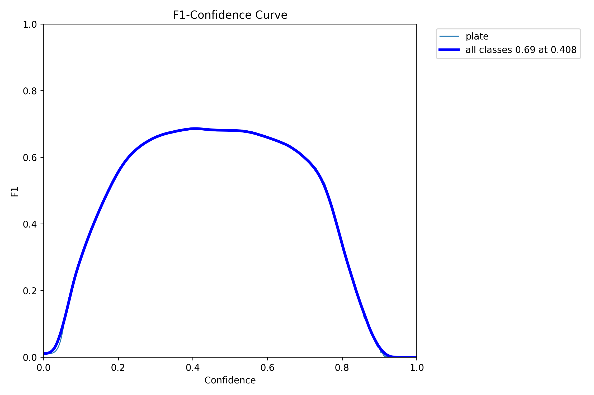 | 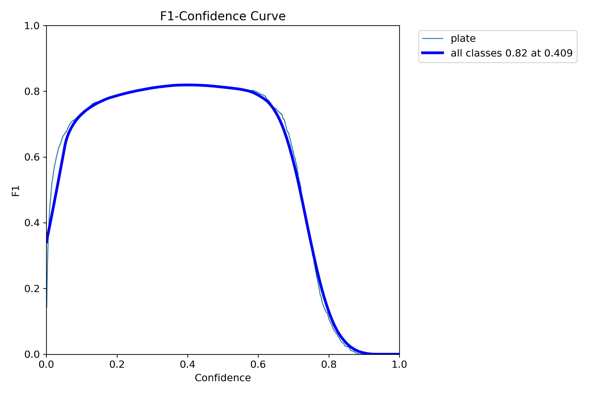 |

**Precision-Confianza**

| RT-DETR | YOLO |
|:---:|:---:|
| 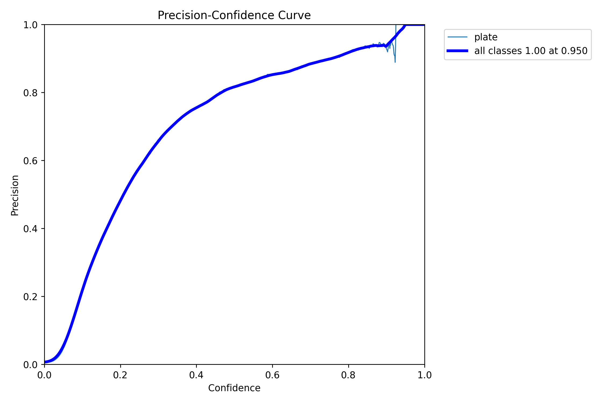 | 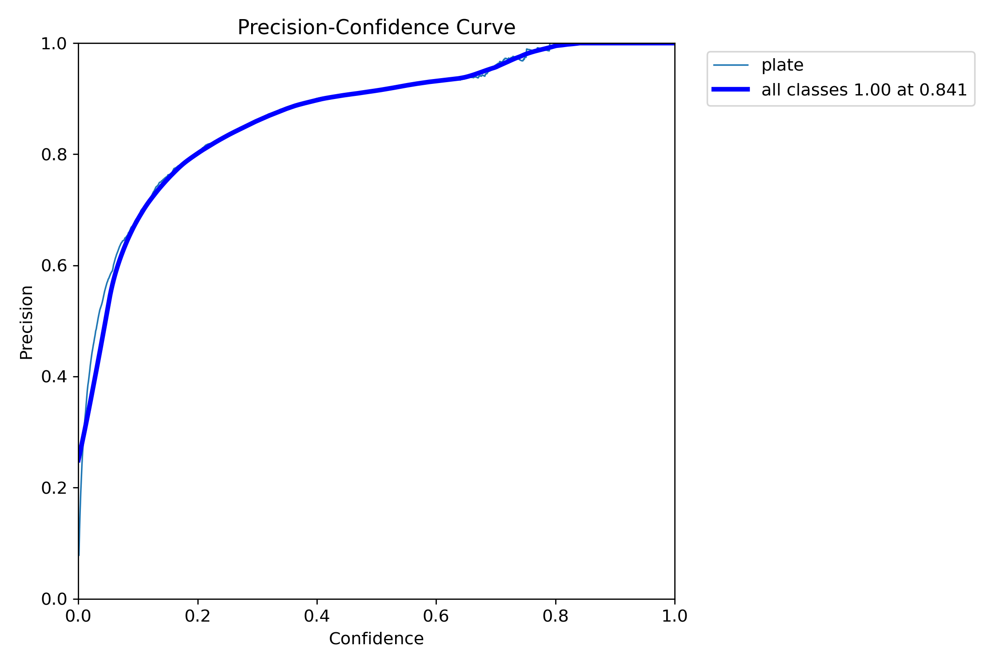 |

**Recall-Confianza**

| RT-DETR | YOLO |
|:---:|:---:|
| 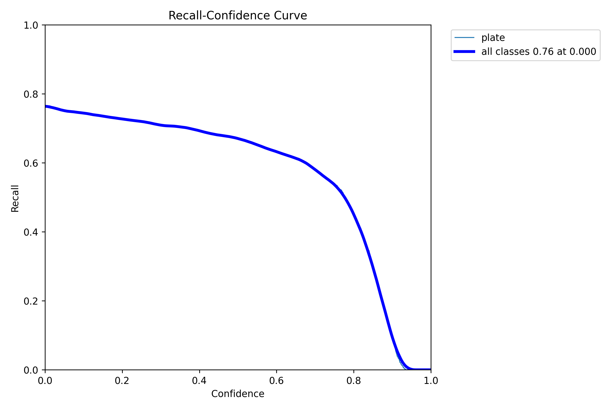 | 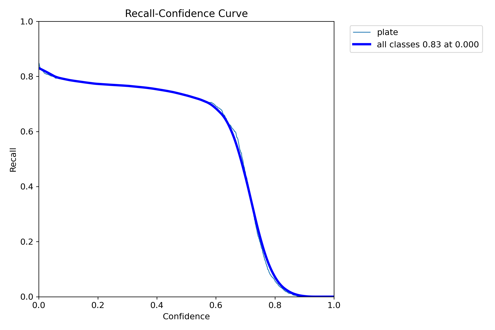 |

### Precision en puntos concretos (aprox.)

| Confianza | RT-DETR | YOLO |
|---:|---:|---:|
| 0.2 | ~0.46 | ~0.81 |
| 0.4 | ~0.78 | ~0.90 |
| 0.6 | ~0.86 | ~0.93 |
| 0.8 | ~0.90 | ~0.99 |

### Recall en puntos concretos (aprox.)

| Confianza | RT-DETR | YOLO |
|---:|---:|---:|
| 0.0 | 0.72 | 0.83 |
| 0.2 | ~0.67 | ~0.77 |
| 0.4 | ~0.61 | ~0.75 |
| 0.6 | ~0.53 | ~0.65 |
| 0.8 | ~0.20 | ~0.10 |

Las curvas de F1, precisión y recall muestran que YOLO ofrece un mejor rendimiento que RT-DETR en esta evaluación: aunque ambos alcanzan su F1 óptimo con un umbral de confianza prácticamente idéntico, cercano a 0.4, YOLO obtiene un máximo de 0.8 frente a 0.7 y mantiene valores elevados en un intervalo más amplio, lo que evidencia menor sensibilidad a la elección del umbral. 
Esta ventaja también se observa en los umbrales medios: con una confianza de aproximadamente 0.4, YOLO alcanza una precisión de 0.9 aproximadamente y un recall de 0.75, frente a 0.78 y 0.61 de RT-DETR, respectivamente. Por tanto, YOLO combina una mayor proporción de detecciones correctas con una mayor recuperación de objetos.  
Aunque ambos modelos llegan a una precisión de 1.00 con umbrales elevados, 0.8 en YOLO y más de 0.8 en RT-DET, este resultado coincide con un recall muy reducido y no representa el mejor equilibrio de funcionamiento. En conjunto, YOLO presenta una relación más favorable entre precisión y recall, mientras que el umbral cercano a 0.41 constituye un punto de partida para ambos modelos si el objetivo es maximizar el F1 en este conjunto de validación.

---

## 3. Curva Precision-Recall

| RT-DETR | YOLO |
|:---:|:---:|
| 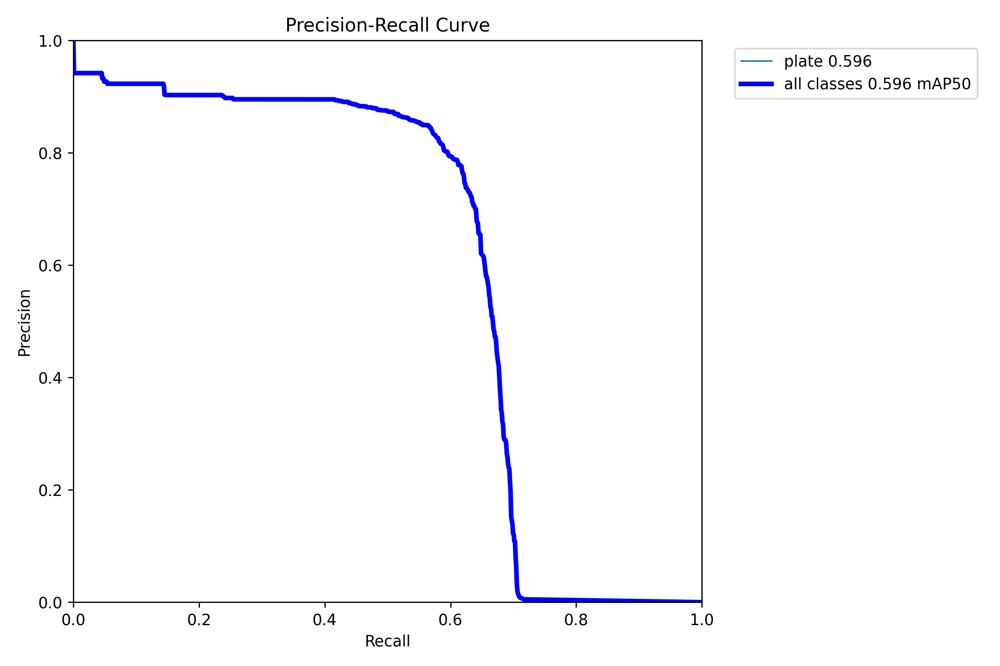 | 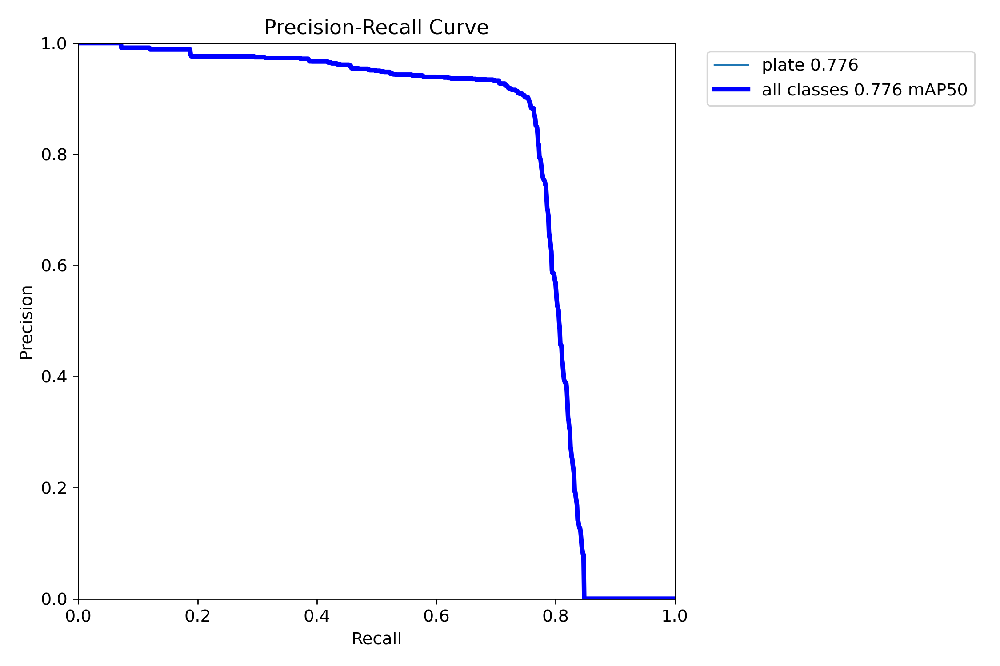 |

| | RT-DETR | YOLO |
|---|---:|---:|
| mAP@50 | 0.6 | 0.78 |
| Recall donde la precisión cae por debajo de 0.8 | ~0.58 | ~0.77 |
| Recall máximo alcanzado | ~0.72 | ~0.85 |
| Precisión en la zona plana (recall 0.2–0.5) | ~0.90 | ~0.94–0.98 |

Estas curvas precisión-recall muestran que YOLO mantiene una mayor precisión para niveles comparables de recall y alcanza un mAP@50 de 0.78, frente a 0.6 de RT-DETR, una diferencia de 18 puntos porcentuales. Esto implica que, en esta evaluación, YOLO puede recuperar más matrículas manteniendo un nivel de precisión similar, por lo que su ventaja no depende únicamente de elegir un umbral de confianza concreto. Por ejemplo, YOLO mantiene una precisión de al menos 0.8 hasta un recall cercano a 0.77, mientras que RT-DETR desciende por debajo de ese nivel alrededor de 0.58, esto supone recuperar aproximadamente un 77% de los objetos frente a un 58%, manteniendo en ambos casos cerca de un 80% de detecciones correctas. 

---

## 4. Matriz de confusión

### Gráficas

**Matriz de confusión (normalizada)**

| RT-DETR | YOLO |
|:---:|:---:|
| 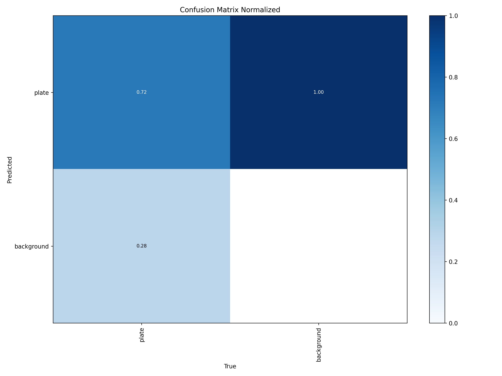 | 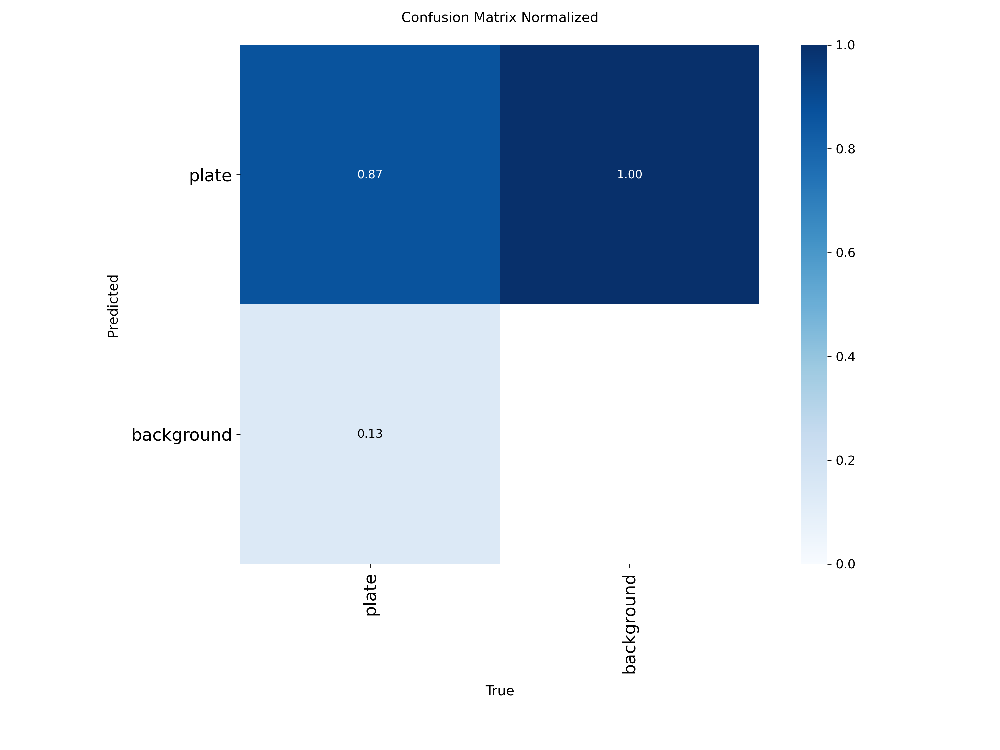 |

### Normalizada (por columna, clase real)

| | RT-DETR | YOLO |
|---|---:|---:|
| Plate detectada correctamente (TP rate / recall) | 0.72 | **0.87** |
| Plate no detectada (predicha como background, FN rate) | 0.28 | **0.13** |
| Background predicho como plate (FP) | 1.00 | 1.00 |

Dado que el conjunto utilizado para generar cada matriz es distinto, se presentan las versiones normalizadas, lo que permite compararlas. El valor de FP = 1.00 se debe a que, en el cálculo de la matriz, los verdaderos negativos no se contabilizan: la fila/columna de la clase “fondo” solo contiene falsos positivos, por lo que al normalizarla todo su contenido queda en 1.00. Este valor es un artefacto de la normalización y no refleja el rendimiento del modelo.
Dichas matrices normalizadas muestran que YOLO detecta correctamente el 87% de las placas reales, frente al 72% de RT-DETR. Esto implica que, por cada 100 placas reales, YOLO detectaría aproximadamente 87 y omitiría 13, mientras que RT-DETR detectaría 72 y omitiría 28; por tanto, YOLO reduce las omisiones en aproximadamente un 54% respecto a RT-DETR, una ventaja relevante cuando se busca evitar que las placas pasen inadvertidas. 

## 5. Evolución durante el entrenamiento

**RT-DETR**

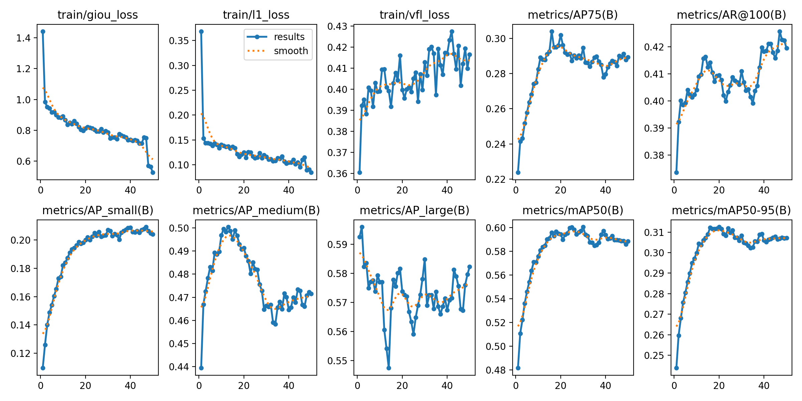

**YOLO**

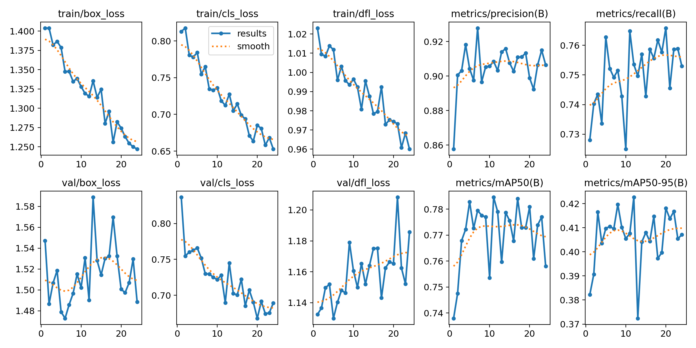

| | RT-DETR | YOLO |
|---|---|---|
| Epochs | 50 | 24 |
| Pico de mAP@50 | ~0.60 (epoch ~25–30) | ~0.785 (epochs 11 y 17) |
| Pico de mAP@50-95 | ~0.312 (epoch ~20) | ~0.423 (epoch 13) |
| Tendencia final de mAP@50 | Ligero descenso (0.60 → 0.588) | Estable con oscilaciones (0.77 ± 0.01) |
| Estabilidad entre epochs | Estable | Oscilaciones notables (±0.02 en mAP@50) |

En cuanto a la evolución del entrenamiento, se observa un comportamiento diferente entre ambos modelos.  Por un lado, RT-DETR alcanza su meseta de rendimiento aproximadamente en el epoch 20, a partir del cual sus métricas de detección dejan de mejorar y experimentan un ligero deterioro, a pesar de que las pérdidas de entrenamiento continúan disminuyendo. En concreto, la GIoU Loss desciende de aproximadamente 1,45 a 0,53 y la L1 Loss de 0,37 a 0,085, mientras que la VFL Loss presenta una tendencia ligeramente ascendente. Este comportamiento podría indicar un posible sobreajuste. 
Por otro lado, YOLO muestra una convergencia considerablemente más rápida, concentrando la mayor parte de la mejora durante las primeras 10 épocas y manteniendo posteriormente valores de mAP relativamente estables, aunque con ciertas oscilaciones entre iteraciones. Estas fluctuaciones sugieren que el entrenamiento podría beneficiarse de un ajuste progresivo del learning rate durante las últimas épocas. En conjunto, YOLO destaca por alcanzar un rendimiento superior en un menor número de épocas, mientras que RT-DETR necesita más iteraciones y presenta indicios de estancamiento en las fases finales del entrenamiento. 

### Otras métricas exclusivas de RT-DETR

| Métrica | Valor aprox. (último epoch) |
|---|---:|
| AP75 | 0.29 |
| AR@100 | 0.42 |
| AP small | 0.20 |
| AP medium | 0.47 |
| AP large | 0.58 |

En cuanto a las métricas adicionales de RT-DETR, se observa que el modelo presenta un comportamiento condicionado por el tamaño de los objetos detectados. El AP75 alcanza un valor aproximado de 0,29, lo que refleja un rendimiento más limitado cuando se exige un mayor grado de solapamiento entre las cajas predichas y las anotadas. Al analizar el rendimiento según el tamaño de los objetos, se aprecia una diferencia considerable: el AP para objetos pequeños alcanza únicamente 0,20, mientras que para objetos medianos aumenta hasta 0,47 y para objetos grandes llega a 0,58. Esto evidencia que el modelo RT-DETR entrenado, presenta mayores dificultades para localizar objetos de dimensiones reducidas, obteniendo resultados progresivamente mejores a medida que aumenta su tamaño.

## 6. Comparaciones reales

A través de la evaluación de 200 imágenes con cada modelo se han guardado las matrículas que detecta y las que no detecta cada uno (carpetas `detectadas` y `no_detectadas` dentro de [`resultados/YOLO`](../resultados/YOLO) y [`resultados/RTDETR`]((../resultados/RTDETR))). De ellas se ha seleccionado un pequeño número de imágenes representativas que se agrupan en las 4 combinaciones posibles.

### Matrículas que ambos modelos han sido capaces de detectar

| YOLO | RT-DETR |
|:---:|:---:|
|  | 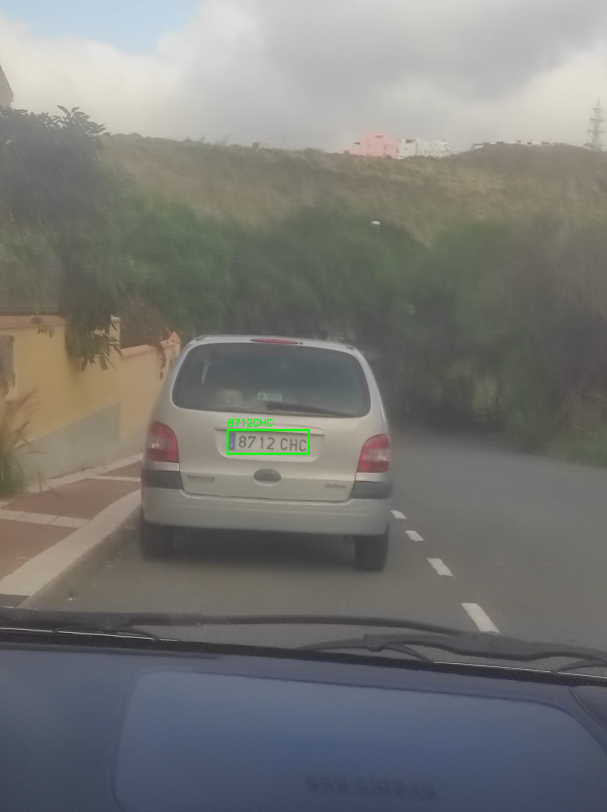 |
| .jpeg>) | .jpeg>) |

Ambos modelos detectan sin problema las matrículas bien iluminadas y que están de frente a la cámara. En estas condiciones el tamaño de la matrícula, el contraste de los caracteres y la ausencia de deformaciones por perspectiva facilitan la localización, y la diferencia entre YOLO y RT-DETR no está en detectar o no, sino en la precisión de la caja y en la confianza.

### Matrículas que solo ha conseguido detectar YOLO

| YOLO (la detecta) | RT-DETR (no la detecta) |
|:---:|:---:|
| .jpeg>) | .jpeg>) |
| .jpeg>) | .jpeg>) |

En estas imágenes se aprecia que YOLO tiene mayor capacidad para detectar matrículas más lejanas y ladeadas, es decir, fuera de las condiciones ideales. Esto es coherente con que se entrenara con una resolución de entrada de 960 px  frente a los 640 px de RT-DETR.

### Matrículas que solo ha conseguido detectar RT-DETR

| YOLO (no la detecta) | RT-DETR (la detecta) |
|:---:|:---:|
| .jpeg>) | .jpeg>) |
| 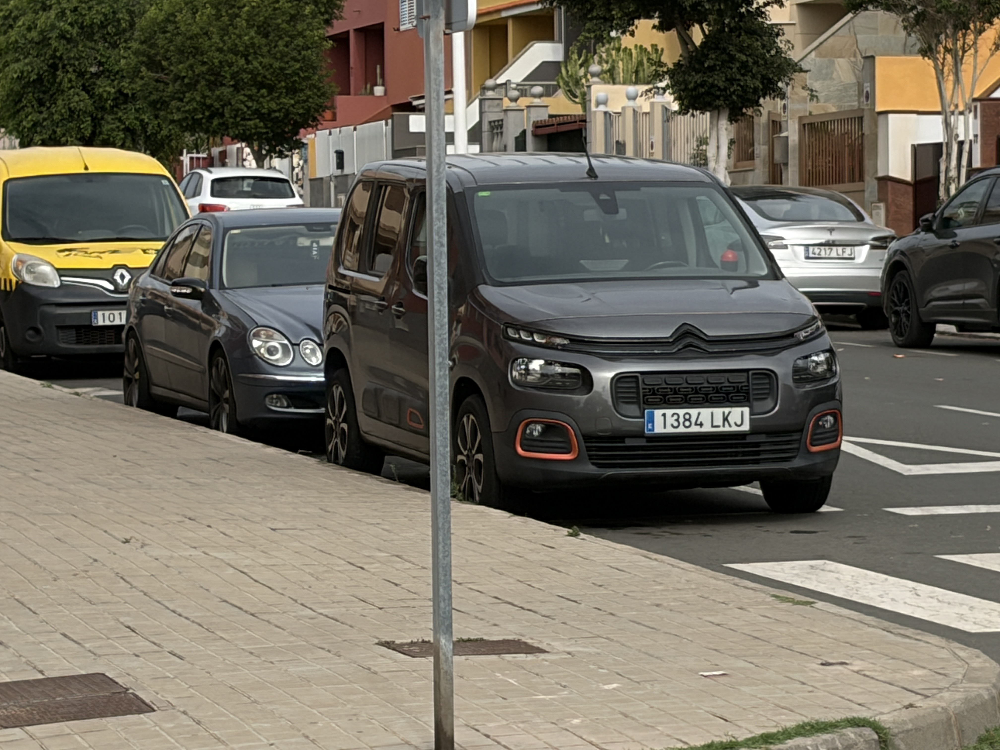 | 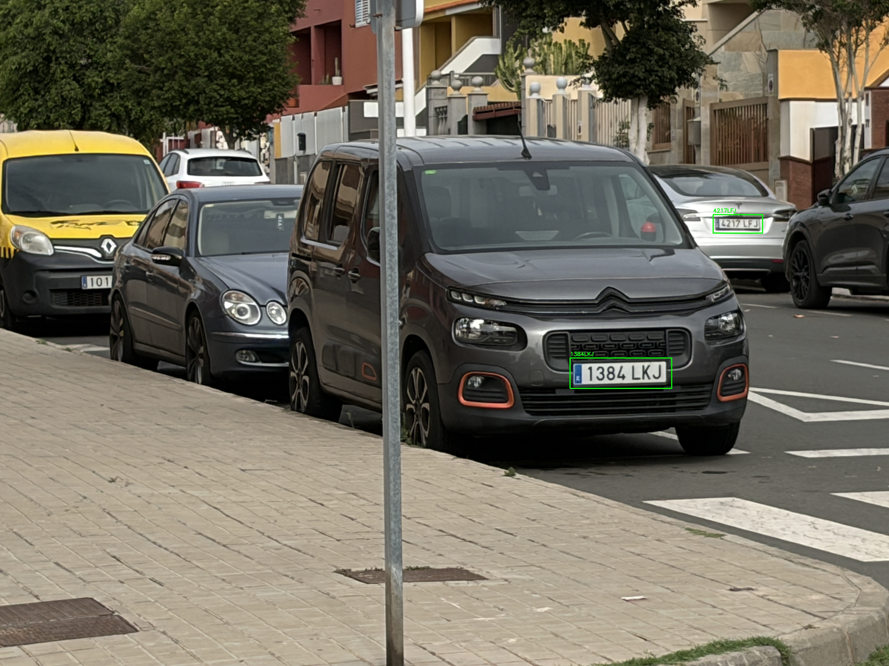 |

En este caso se puede apreciar como  RT-DETR puede ofrecer un mejor rendimiento ante determinadas variaciones de orientación y perspectiva. 

### Matrículas que no ha conseguido detectar ninguno de los dos modelos

| YOLO (no la detecta) | RT-DETR (no la detecta) |
|:---:|:---:|
| .jpeg>) | .jpeg>) |

Este es el único caso en el que ninguno de los dos modelos ha conseguido detectar las matrículas. Esto podría deberse a que las condiciones de la imagen no favorecen la detección, ya que ambas matrículas aparecen ligeramente difuminadas y una de ellas tiene un tamaño muy reducido.
