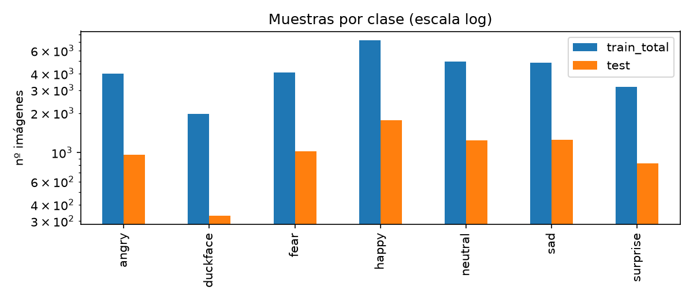
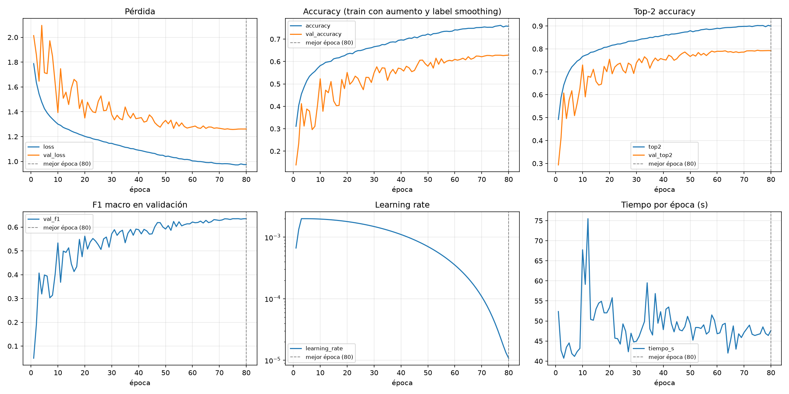
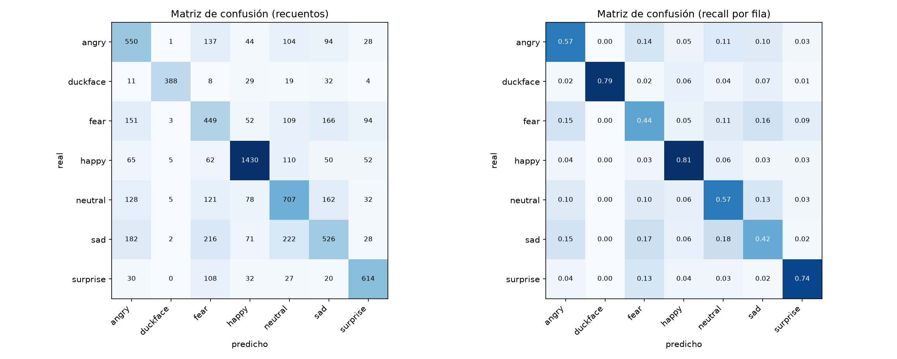
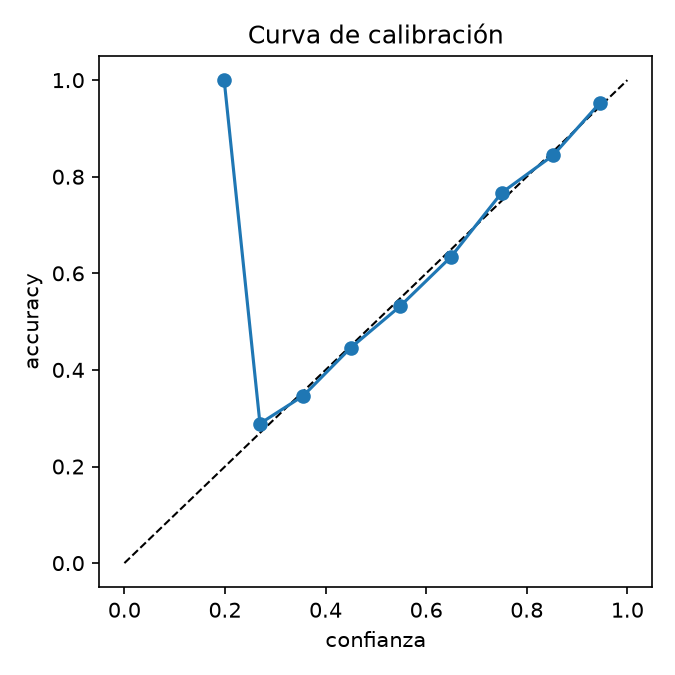

# Práctica 5

En este directorio del repositorio encontrarán múltiples cuadernos jupyter, cada uno destinado a una serie de tareas concretas. El objetivo de la práctica es construir un **modelo biométrico propio** capaz de reconocer 7 expresiones faciales (`angry`, `duckface`, `fear`, `happy`, `neutral`, `sad` y `surprise`), compararlo con alternativas clásicas y con DeepFace, y aplicarlo en dos demostradores con webcam. Los distintos archivos son:
- [`preparar_dataset.ipynb`](./preparar_dataset.ipynb) -> destinado a la construcción de la clase `duckface` a partir del Selfie-dataset y de Roboflow y al recuento final por clase.
- [`entrenar_01_hog_svm.ipynb`](./entrenar_01_hog_svm.ipynb), [`entrenar_02_lbp_svm.ipynb`](./entrenar_02_lbp_svm.ipynb), [`entrenar_03_hoglbp_pca_svm.ipynb`](./entrenar_03_hoglbp_pca_svm.ipynb), [`entrenar_04_autocaras_pca_svm.ipynb`](./entrenar_04_autocaras_pca_svm.ipynb), [`entrenar_05_hog_pca_knn.ipynb`](./entrenar_05_hog_pca_knn.ipynb) -> destinados al entrenamiento y evaluación de los cinco clasificadores clásicos.
- [`entrenar_06_cnn.ipynb`](./entrenar_06_cnn.ipynb) -> destinado al entrenamiento de la red convolucional propia (tipo mini-Xception) junto a las gráficas y tablas del [informe de entrenamiento](./informe_entrenamiento).
- [`comparativa.ipynb`](./comparativa.ipynb) -> destinado a evaluar todos los modelos en las mismas condiciones (calidad, velocidad y coste) y a compararlos con DeepFace.
- [`conclusiones_comparativas.md`](./conclusiones_comparativas.md) -> explicación detallada de los distintos datos comparativos extraídos en `comparativa.ipynb`.
- [`emociones_políticas.ipynb`](./emociones_políticas.ipynb) -> demostrador en directo: reacciones de partidos políticos según la emoción de la persona.
- [`filtro_derechos.ipynb`](./filtro_derechos.ipynb) -> demostrador en directo: filtro humorístico de "derechos" según el país elegido.
- [`INFORME_P5.md`](./INFORME_P5.md) -> informe técnico con diagramas de flujo del entrenamiento de los modelos 04, 05 y 06 y del funcionamiento detallado de `emociones_políticas`.

Todos los cuadernos dependen del archivo [`comun.py`](./comun.py), que recoge las funciones comunes (detector de caras, landmarks, extractores de características, carga del dataset, cámara, etc.) para reducir la duplicidad en el código. Los dos demostradores utilizan además [`selector.py`](./selector.py), que dibuja el selector lateral de imágenes (partidos o banderas).

### 👥 Autores:
- [Enrique Sosa Ojeda](https://github.com/Enric1005)
- [Vidal de León Giménez](https://github.com/t3ntox)

------

## Dataset
El dataset contiene **30.241 imágenes de entrenamiento y 7.396 de test**, en escala de grises y a 48x48, organizadas en una carpeta por emoción dentro de `dataset/train` y `dataset/test`. Se construye a partir de tres fuentes:

| Origen | Clases | Formato |
|---|---|---|
| FER-2013 (Kaggle) | angry, fear, happy, neutral, sad, surprise | 48x48, gris, cara ya recortada |
| Selfie-dataset (columna `duck_face`) | duckface | fotos de móvil en color, recortadas con el detector DNN |
| Roboflow (`middle-tongue-duckface`) | duckface | caras convertidas al formato FER (gris, 48x48) |

Las decisiones principales, desarrolladas en [`preparar_dataset.ipynb`](./preparar_dataset.ipynb), son:
- **`disgust` eliminada**: en FER-2013 solo cuenta con el 1,4 % de las imágenes de train y su mezcla con `angry` empeoraba ambas clases.
- **`duckface` creada por nosotros**: de los 46.836 selfies del Selfie-dataset se toman los marcados como `duck_face`, se detecta la cara con el DNN (ResNet10-SSD), se recorta con `recortar_cara` (la misma función que se usa en la webcam, para que el encuadre de entrenamiento e inferencia sea idéntico), se pasa a gris y se reduce a 48x48. Se reparte un 80 % para train y un 20 % para test con semilla fija.
- **Roboflow como fuente adicional**: para ampliar la clase `duckface` se añaden también las caras del proyecto `middle-tongue-duckface` de Roboflow, convertidas al mismo formato que el resto del dataset.
- **Sesgo de dominio conocido**: todas las imágenes de `duckface` proceden de selfies de móvil y de Roboflow, mientras que el resto proviene de FER-2013, por lo que parte de su buen resultado puede deberse al dominio y no solo a la expresión.

El desbalance entre clases (`happy` ≈ 24 % frente a `duckface` ≈ 6,5 %) se compensa durante el entrenamiento con pesos de clase. La distribución completa se encuentra en [distribucion_clases.csv](./informe_entrenamiento/distribucion_clases.csv).



------

## Entrenamiento
Todos los modelos reciben la cara ya recortada y se guardan en el directorio `modelos/`: los clásicos como un único `Pipeline` (extractor + clasificador) y la CNN en formato `.keras`, de modo que se pueden usar directamente desde los demostradores. Cada cuaderno registra su tiempo de entrenamiento y sus métricas en [registro_modelos.json](./informe_entrenamiento/registro_modelos.json).

### Modelos clásicos
Los cinco cuadernos `entrenar_01` a `entrenar_05` siguen la misma estructura: carga del dataset, extracción de características con la clase `Extractor`, definición del clasificador, entrenamiento, evaluación sobre el test y guardado. Las características se calculan tras ecualizar el histograma de la cara. Los clasificadores son:

| Cuaderno | Características | Clasificador |
|---|---|---|
| [`entrenar_01`](./entrenar_01_hog_svm.ipynb) | HOG (64x64, 9 orientaciones, celdas de 8x8) | `StandardScaler` + SVM RBF (`C=5`) |
| [`entrenar_02`](./entrenar_02_lbp_svm.ipynb) | LBP uniforme por celdas (64x64, 8x8 celdas) | `StandardScaler` + SVM RBF (`C=5`) |
| [`entrenar_03`](./entrenar_03_hoglbp_pca_svm.ipynb) | HOG + LBP concatenados | `StandardScaler` + PCA (95 % de varianza) + SVM RBF |
| [`entrenar_04`](./entrenar_04_autocaras_pca_svm.ipynb) | Píxeles (32x32), *autocaras* | PCA (150 componentes, con blanqueamiento) + SVM RBF |
| [`entrenar_05`](./entrenar_05_hog_pca_knn.ipynb) | HOG | `StandardScaler` + PCA (100 componentes) + KNN (`k=7`, pesado por distancia) |

Todas las SVM usan `class_weight="balanced"`. En el cuaderno de HOG + SVM se incluye además una búsqueda en rejilla opcional (`BUSCAR_HIPERPARAMETROS`) de `C` y `gamma` con validación cruzada de 3 particiones sobre 6.000 muestras, optimizando el F1 macro.

### [CNN propia (mini-Xception)](./entrenar_06_cnn.ipynb)
La red está inspirada en mini-Xception y cuenta con tan solo **92.791 parámetros** (un modelo de 0,5 MB). Recibe imágenes de 48x48 en un canal y está formada por:
- Capas de aumento de datos (volteo horizontal, rotación, zoom y traslación), que solo actúan al entrenar.
- Dos convoluciones iniciales de 8 filtros.
- Cuatro bloques residuales de 16, 32, 96 y 160 filtros, con 2 convoluciones separables en profundidad, `BatchNormalization` y atajo 1x1.
- Una convolución final con 7 filtros seguida de `GlobalAveragePooling` y *softmax*, sin capas densas.

La arquitectura completa se encuentra en [arquitectura.txt](./informe_entrenamiento/arquitectura.txt). Las condiciones principales del entrenamiento son:
- 80 épocas, batch de 128 y semilla fija (`SEED=42`)
- Optimizador `AdamW` con `weight_decay=1e-4`, calentamiento lineal de 3 épocas hasta `lr=2e-3` y decaimiento coseno hasta `1e-5`
- Suavizado de etiquetas de 0,1
- Pesos de clase balanceados y suavizados con raíz cuadrada (`PESO_CLASE_POTENCIA=0.5`) para no desestabilizar el gradiente
- Un 10 % estratificado del train como validación, usado para seleccionar la mejor época (parada temprana con `patience=20`, aunque no llegó a activarse)
- Precisión mixta si hay GPU; el modelo final se reconstruye y exporta siempre en `float32` para inferir en CPU

El entrenamiento se realizó en CPU (16 núcleos, sin GPU) con TensorFlow 2.21 / Keras 3.15 y tardó unos **60 minutos** (≈ 44 s por época). La mejor época fue la 61, con un accuracy de validación de 0,597.



### Resultados de la CNN
Las métricas sobre cada conjunto, extraídas de [metricas_globales.csv](./informe_entrenamiento/metricas_globales.csv), son:

| Conjunto | Accuracy | F1 macro | Top-2 |
| :------: | :------: | :------: | :---: |
| Train (sin aumento) | 0.715 | 0.721 | 0.873 |
| Validación | 0.597 | 0.602 | 0.780 |
| Test | 0.605 | 0.615 | 0.786 |
| Test + TTA (volteo) | **0.625** | **0.636** | 0.805 |

El TTA (*test-time augmentation*) consiste en promediar la predicción de la cara con la de su versión volteada, lo que mejora el resultado a cambio de duplicar el coste de inferencia.

Resultados por clase en test ([informe_por_clase.csv](./informe_entrenamiento/informe_por_clase.csv)):

| Clase | Precision | Recall | F1-Score | Soporte |
| :---: | :-------: | :----: | :------: | :-----: |
| **angry** | 0.551 | 0.458 | 0.500 | 958 |
| **duckface** | 0.928 | 0.860 | 0.893 | 329 |
| **fear** | 0.407 | 0.448 | 0.426 | 1024 |
| **happy** | 0.778 | 0.840 | 0.808 | 1774 |
| **neutral** | 0.518 | 0.564 | 0.540 | 1233 |
| **sad** | 0.507 | 0.387 | 0.439 | 1247 |
| **surprise** | 0.655 | 0.753 | 0.701 | 831 |
| **Global (Accuracy)** | | | **0.605** | 7396 |

**Análisis:**
- **Clases fáciles:** `duckface`, `happy` y `surprise`. Hay que tener en cuenta que `duckface` proviene de otro dominio (selfies), lo que puede inflar su resultado.
- **Clases difíciles:** `fear`, `sad` y `angry`, que son además las que tienen las etiquetas más ambiguas en FER-2013. Las confusiones más frecuentes ([confusiones_top.csv](./informe_entrenamiento/confusiones_top.csv)) son `sad` → `neutral` (19,5 % de las `sad`), `sad` → `fear` (18,4 %) y `angry` → `fear` (16,3 %).
- **Sobreajuste:** la brecha entre train (0,715) y test (0,605) es de ≈ 0,11, lo que indica un sobreajuste moderado. La pérdida de validación alcanza su mínimo en la época 63 y a partir de ahí la validación se estanca.
- **Calibración:** el error de calibración esperado (ECE) es de solo 0,022, por lo que la confianza que muestra la red se corresponde muy bien con su probabilidad real de acierto, algo útil para mostrarla en directo ([calibracion.csv](./informe_entrenamiento/calibracion.csv)).
- **Latencia en CPU:** una cara tarda ≈ 41 ms en modo dinámico frente a ≈ 2,7 ms envolviendo la red en `tf.function`, por lo que los demostradores utilizan esta segunda opción.





------

## [Comparativa de modelos](./comparativa.ipynb)
Todos los modelos se evalúan en las mismas condiciones sobre el mismo conjunto de test, midiendo la calidad, la latencia de **una cara** (incluyendo la extracción de características) y el coste en tamaño y tiempo de entrenamiento. El resumen de los resultados es el siguiente:

| Modelo | Accuracy | F1 macro | ms / cara | Tamaño (MB) | Entrenamiento |
| :----- | :------: | :------: | :-------: | :---------: | :-----------: |
| HOG + SVM | 0.560 | 0.564 | 32.5 | 389.3 | - |
| LBP + SVM | 0.438 | 0.448 | 17.6 | 147.8 | 1598 s |
| HOG + LBP + PCA + SVM | 0.567 | 0.576 | 31.0 | 214.7 | 1372 s |
| Autocaras (PCA) + SVM | 0.504 | 0.516 | 4.6 | 36.1 | 274 s |
| HOG + PCA + KNN | 0.499 | 0.498 | 5.1 | 12.5 | 1.8 s |
| **CNN mini-Xception** | 0.605 | 0.615 | **2.7** | **0.5** | 3581 s |
| **CNN mini-Xception + TTA** | **0.625** | **0.636** | 5.4 | 0.5 | 3581 s |

> El tiempo de entrenamiento de HOG + SVM no figura porque `registro_modelos.json` no contiene su entrada, y las salidas guardadas de [`entrenar_01`](./entrenar_01_hog_svm.ipynb) corresponden a una ejecución con la versión anterior del dataset. Conviene volver a ejecutar ese cuaderno y después la comparativa.

Frente a DeepFace, sobre un subconjunto equilibrado de 600 caras sin `duckface`, la CNN propia obtiene una accuracy de 0.587 (0.597 con TTA) frente al 0.563 de DeepFace, siendo además unas 5 veces más rápida por cara.

Para el prototipo en tiempo real se elige por tanto la **CNN propia**, que es a la vez la más precisa, la más rápida y la más ligera. El demostrador la usa sin TTA (≈ 2,7 ms por cara); el TTA (F1 0,636 a ≈ 5,4 ms) queda como mejora opcional.

La explicación de cada uno de los datos comparativos (métricas globales, F1 por clase, matrices de confusión, latencias, tamaños y comparación con DeepFace), junto a sus gráficas, se encuentra en [`conclusiones_comparativas.md`](./conclusiones_comparativas.md).

------

## Demostradores en tiempo real
Ambos demostradores usan el detector de caras DNN de OpenCV (ResNet10-SSD) y se controlan por teclado. La cámara se lee en un hilo aparte (`Camara`) para que el bucle procese siempre el último fotograma.

### [Emociones políticas](./emociones_políticas.ipynb)
La persona se pone delante de la cámara, elige un partido político (PSOE, PP, Vox o Frente Amplio) y, según la expresión que haga, aparece sobre su cabeza una imagen que hace referencia a dicho partido y emoción. Las imágenes están en [`emotion-images`](./emotion-images) (una carpeta por partido con una imagen por emoción) y los logotipos del selector en [`logos-partidos`](./logos-partidos).

1. Se detecta la cara más grande con el DNN y se suaviza su caja entre frames.
2. Con los **landmarks de MediaPipe** se calcula la inclinación de la cabeza, se gira la imagen para dejar los ojos en horizontal antes de clasificar y se ancla la imagen al punto de la frente, girándola con la cabeza.
3. Se obtienen las probabilidades de la emoción con el modelo activo y se suavizan con una **media móvil exponencial** (`ALPHA_SUAVIZADO=0.35`). Así la imagen no parpadea cuando el modelo duda entre dos emociones y la confianza mostrada es una probabilidad real.

Con la tecla `m` se puede cambiar en directo entre la **CNN propia**, un **modelo clásico** y **DeepFace** (este último en un hilo aparte por su latencia), mostrando en pantalla el modelo activo y su tiempo por cara. Todos comparten la misma interfaz `probs(cara_gris)`.

**Teclas:** `n`/`b` partido siguiente/anterior · `m` cambiar modelo · `l` mostrar landmarks · `f` pantalla completa · `Esc` salir.

### [Filtro de derechos](./filtro_derechos.ipynb)
Filtro con tono **humorístico y satírico** (las estimaciones no son mediciones reales ni pretenden ofender a ningún colectivo). Detecta la cara de la persona, estima su **género**, su **tono de piel** y si lleva el **pelo visible o cubierto**, y a partir de ellos calcula un porcentaje de "derechos" según el país seleccionado.

- **Género:** `DeepFace.analyze` en un hilo, con votación entre los últimos resultados.
- **Segmentación:** MediaPipe Image Segmenter (`selfie_multiclass_256x256`) para separar piel, pelo y accesorios.
- **Tono de piel:** se calcula el **ITA** sobre los píxeles de piel en espacio Lab y se clasifica en claro, intermedio u oscuro con histéresis. Solo se fía de la medida con buena luz (se descartan imágenes oscuras, quemadas o con luz lateral).
- **Pelo:** se decide si está visible, parcial, cubierto o no hay pelo mirando la corona y los laterales de la cabeza, y se clasifica su color.
- **Métrica:** `calcular_derechos` combina un factor por género (`W_G=0.4`), por tono de piel respecto al mayoritario del país (`W_S=0.4`) y por pelo, que solo penaliza en países con regla de cubrir el pelo (`W_P=0.2`). Los factores de cada país están en [paises.csv](./paises.csv) y sus banderas, descargadas automáticamente, en [`banderas`](./banderas).

Para que la medición se vea fluida, los análisis pesados se lanzan en hilos independientes con intervalos mínimos, y al pulsar `e` se muestra una animación de 4 segundos hasta fijar el porcentaje.

**Teclas:** `e` medir · `n`/`b` cambiar país · `d` mostrar/ocultar parámetros · `+`/`-` calibrar el offset del tono de piel · `f` pantalla completa · `Esc` salir.

------

## Archivos necesarios
- `dataset/` — carpetas `train` y `test` con una subcarpeta por emoción, más `Selfie-dataset.tar.gz` (hay que descomprimirlo en `dataset/` antes de ejecutar `preparar_dataset.ipynb`). El FER-2013 se obtiene de Kaggle.
- `modelos/` — modelos entrenados (`.joblib` y `cnn.keras`) y modelos preentrenados necesarios para los demostradores: `deploy.prototxt.txt` y `res10_300x300_ssd_iter_140000.caffemodel` (detector de caras), `face_landmarker.task` (landmarks, se descarga automáticamente si no existe) y `selfie_multiclass_256x256.tflite` (segmentación, también se descarga automáticamente).
- `emotion-images/`, `logos-partidos/`, `banderas/` y `paises.csv` — recursos de los demostradores.

Estructura de la carpeta
```
P5
|- banderas/                         #Banderas de los países (caché del selector)
|- dataset/                          #Dataset de emociones (train/test) y Selfie-dataset
|- emotion-images/                   #Imágenes de reacción por partido y emoción
|- informe_entrenamiento/            #Gráficas, tablas y resúmenes del entrenamiento y la comparativa
|- logos-partidos/                   #Logotipos del selector de partidos
|- modelos/                          #Modelos entrenados y modelos preentrenados
|- comparativa.ipynb                 #Comparativa de todos los modelos y frente a DeepFace
|- conclusiones_comparativas.md      #Explicación de los datos de la comparativa
|- comun.py                          #Funciones comunes a todos los cuadernos
|- emociones_políticas.ipynb         #Demostrador de reacciones políticas
|- entrenar_01_hog_svm.ipynb         #Entrenamiento HOG + SVM
|- entrenar_02_lbp_svm.ipynb         #Entrenamiento LBP + SVM
|- entrenar_03_hoglbp_pca_svm.ipynb  #Entrenamiento HOG + LBP + PCA + SVM
|- entrenar_04_autocaras_pca_svm.ipynb #Entrenamiento autocaras (PCA) + SVM
|- entrenar_05_hog_pca_knn.ipynb     #Entrenamiento HOG + PCA + KNN
|- entrenar_06_cnn.ipynb             #Entrenamiento de la CNN propia
|- filtro_derechos.ipynb             #Demostrador del filtro de derechos
|- INFORME_P5.md                     #Informe técnico con diagramas de flujo
|- paises.csv                        #Factores por país del filtro de derechos
|- preparar_dataset.ipynb            #Preparación de la clase duckface
|- README.md
|- selector.py                       #Selector lateral de imágenes
```

------

## Dependencias
Todos los cuadernos se han ejecutado en un entorno de Python 3.11 con las siguientes librerías:

- `opencv-contrib-python` (4.x): lectura de cámara, detector de caras DNN con modelos Caffe y dibujo. Debe instalarse un único paquete de OpenCV, ya que OpenCV 5 no puede leer modelos Caffe.
- `scikit-learn` y `scikit-image`: clasificadores clásicos (SVM, KNN, PCA), métricas y extracción de HOG y LBP.
- `joblib`: serialización de los pipelines clásicos.
- `tensorflow` y `keras`: construcción, entrenamiento e inferencia de la CNN propia.
- `mediapipe`: landmarks faciales y segmentación de pelo y piel.
- `deepface`: estimación de emociones (comparativa y demostrador) y de género (filtro de derechos).
- `numpy`, `pandas` y `matplotlib`: tratamiento de datos y generación de las gráficas.
- `ipykernel`: ejecución de los cuadernos Jupyter.

------


Durante la realización del código de esta práctica se ha hecho uso de la IA Claude.
