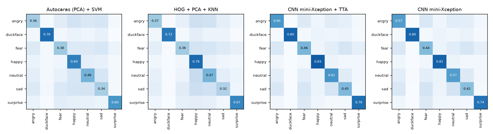
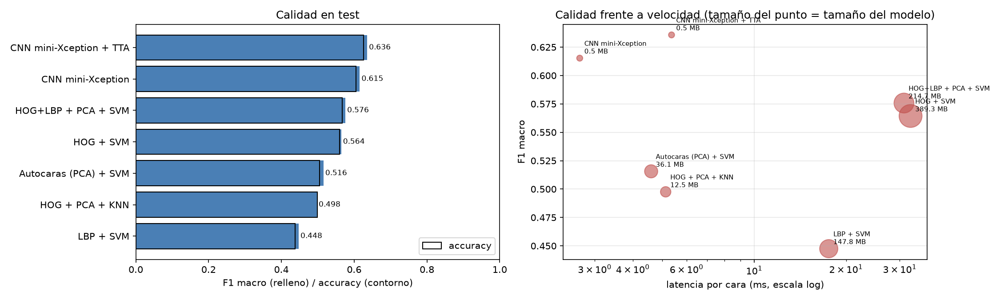

# Conclusiones de la comparativa · Práctica 5

En este documento se explican de forma breve los distintos datos comparativos extraídos en el cuaderno [`comparativa.ipynb`](./comparativa.ipynb). Todos los archivos citados se encuentran en el directorio [`informe_entrenamiento`](./informe_entrenamiento).

Todos los modelos se evalúan **en las mismas condiciones**: se cargan desde `modelos/`, reciben la cara en escala de grises y se prueban sobre el mismo conjunto de test (7.396 imágenes, 7 clases). La CNN se evalúa sola y con TTA (*test-time augmentation*, promedio de la predicción de la cara y de su versión volteada).

------

## 1. Métricas globales de calidad
Recogidas en [comparativa_modelos.csv](./informe_entrenamiento/comparativa_modelos.csv). Se calculan cuatro métricas:
- **Accuracy**: porcentaje total de aciertos. Está dominada por las clases más abundantes (`happy` supone un 24 % del test).
- **Accuracy balanceada**: media del recall de cada clase, de modo que todas pesan lo mismo.
- **F1 macro**: media del F1 de cada clase. Es la métrica principal de la comparativa, ya que penaliza tanto los falsos positivos como los falsos negativos en todas las clases por igual.
- **Accuracy sin `duckface`**: accuracy calculada solo sobre las 6 emociones de FER-2013, para descartar que el resultado global se apoye en la clase creada por nosotros.

| Modelo | Accuracy | Acc. balanceada | F1 macro | Acc. sin duckface |
| :----- | :------: | :-------------: | :------: | :---------------: |
| HOG + SVM | 0.560 | 0.571 | 0.564 | 0.547 |
| LBP + SVM | 0.438 | 0.461 | 0.448 | 0.419 |
| HOG + LBP + PCA + SVM | 0.567 | 0.584 | 0.576 | 0.552 |
| Autocaras (PCA) + SVM | 0.504 | 0.514 | 0.516 | 0.493 |
| HOG + PCA + KNN | 0.499 | 0.511 | 0.498 | 0.485 |
| CNN mini-Xception | 0.605 | 0.616 | 0.615 | 0.593 |
| **CNN mini-Xception + TTA** | **0.625** | **0.639** | **0.636** | **0.612** |

- Las cuatro métricas ordenan los modelos de la misma forma: CNN con TTA, CNN, HOG + LBP + PCA + SVM, HOG + SVM, autocaras, HOG + PCA + KNN y LBP + SVM.
- La accuracy balanceada es algo mayor que la accuracy en todos los modelos, lo que indica que las clases minoritarias (`duckface` y `surprise`) se reconocen mejor que la media y que los pesos de clase cumplen su función.
- Al quitar `duckface` la accuracy baja entre 1,1 y 1,9 puntos en todos los modelos. La clase propia ayuda al resultado global, pero no lo explica: el orden entre modelos se mantiene igual.
- El mejor clásico, HOG + LBP + PCA + SVM, queda a unos 4 puntos de F1 de la CNN sin TTA y a 6 de la CNN con TTA.

------

## 2. F1 por clase
Recogido en [comparativa_f1_por_clase.csv](./informe_entrenamiento/comparativa_f1_por_clase.csv) (sin TTA). Permite ver si un modelo gana en general o solo en algunas clases. En negrita el mejor de cada clase:

| Modelo | angry | duckface | fear | happy | neutral | sad | surprise |
| :----- | :---: | :------: | :--: | :---: | :-----: | :-: | :------: |
| HOG + SVM | 0.427 | 0.746 | 0.420 | 0.719 | 0.500 | 0.443 | 0.696 |
| LBP + SVM | 0.287 | 0.713 | 0.295 | 0.563 | 0.397 | 0.311 | 0.567 |
| HOG + LBP + PCA + SVM | 0.440 | 0.785 | 0.423 | 0.714 | 0.511 | **0.443** | **0.715** |
| Autocaras (PCA) + SVM | 0.368 | 0.724 | 0.379 | 0.645 | 0.462 | 0.365 | 0.667 |
| HOG + PCA + KNN | 0.378 | 0.716 | 0.379 | 0.636 | 0.422 | 0.335 | 0.618 |
| CNN mini-Xception | **0.500** | **0.893** | **0.426** | **0.808** | **0.540** | 0.439 | 0.701 |

- Todos los modelos coinciden en qué clases son **fáciles** (`duckface`, `happy` y `surprise`) y cuáles **difíciles** (`fear`, `sad` y `angry`). Las difíciles son también las de etiquetas más ambiguas en FER-2013.
- La CNN es la mejor en 5 de las 7 clases. Su ventaja es clara en `duckface`, `happy` y `angry` (entre 6 y 11 puntos sobre el mejor clásico de cada clase), mucho menor en `neutral` (unos 3 puntos) y prácticamente nula en `fear`.
- En `sad` y `surprise` el mejor clásico (HOG + LBP + PCA + SVM) supera ligeramente a la CNN, aunque por menos de 1,5 puntos.
- LBP + SVM es el peor en todas las clases: la textura local por sí sola no basta para distinguir expresiones.

------

## 3. Matrices de confusión
Recogidas en [comparativa_confusiones.png](./informe_entrenamiento/comparativa_confusiones.png). Cada matriz está normalizada por filas, de modo que la diagonal es el recall de cada clase.

- En todos los modelos la diagonal es clara en `duckface`, `happy` y `surprise`, mientras que `angry`, `fear`, `neutral` y `sad` forman un bloque en el que los errores se reparten entre sí.
- Los modelos más débiles tienden a "atraer" las predicciones hacia las clases más abundantes: LBP + SVM y HOG + PCA + KNN muestran una columna de `happy` (y `neutral` en el caso de KNN) más marcada, ya que KNN no admite pesos de clase y LBP no separa bien las expresiones.
- El TTA mejora el recall de todas las clases de la CNN, con la mayor subida en `duckface` (0,86 → 0,91).

------

## 4. Rapidez de inferencia
Recogida en las columnas `ms_por_cara`, `ms_por_imagen_en_lote` y `carga_s` de [comparativa_modelos.csv](./informe_entrenamiento/comparativa_modelos.csv):
- **ms por cara**: latencia de **una sola cara**, incluyendo la extracción de características. Es la medida que importa en la webcam. Se toma la mediana sobre 200 caras del test; en la CNN se mide con `tf.function`, igual que en el demostrador.
- **ms por imagen en lote**: tiempo medio al predecir todo el test de una vez. Sirve para ver qué parte del coste es fija por llamada.
- **Carga**: tiempo de cargar el modelo desde disco.

| Modelo | ms / cara | ms / imagen en lote | Carga (s) |
| :----- | :-------: | :-----------------: | :-------: |
| HOG + SVM | 32.5 | 31.7 | 0.25 |
| LBP + SVM | 17.6 | 16.9 | 0.08 |
| HOG + LBP + PCA + SVM | 31.0 | 23.3 | 0.11 |
| Autocaras (PCA) + SVM | 4.6 | 3.7 | 0.05 |
| HOG + PCA + KNN | 5.1 | 1.4 | 0.01 |
| **CNN mini-Xception** | **2.7** | **0.4** | 0.50 |
| CNN mini-Xception + TTA | 5.4 | - | - |

- La CNN es el modelo más rápido por cara (≈ 2,7 ms), y con TTA (≈ 5,4 ms) sigue siendo de sobra para tiempo real.
- Las SVM sobre HOG o LBP son las más lentas, porque cada predicción se compara con miles de vectores de soporte. Su tiempo apenas baja al trabajar en lote (32,5 → 31,7 ms en HOG + SVM), lo que confirma que el coste está en el propio clasificador y no en la extracción.
- KNN y la CNN, en cambio, se aceleran mucho en lote (KNN de 5,1 a 1,4 ms y la CNN de 2,7 a 0,4 ms), ya que gran parte de su coste por cara es fijo por llamada y se reparte al vectorizar.
- Los tiempos de carga son despreciables en todos los casos (como mucho 0,5 s en la CNN, por la inicialización de Keras).

------

## 5. Coste: tamaño y entrenamiento
Recogido en las columnas `tamaño_MB`, `entrenamiento_s` y `parametros` de [comparativa_modelos.csv](./informe_entrenamiento/comparativa_modelos.csv). El tiempo de entrenamiento se lee de [registro_modelos.json](./informe_entrenamiento/registro_modelos.json).

| Modelo | Tamaño (MB) | Entrenamiento |
| :----- | :---------: | :-----------: |
| HOG + SVM | 389.3 | - |
| LBP + SVM | 147.8 | 1598 s (≈ 27 min) |
| HOG + LBP + PCA + SVM | 214.7 | 1372 s (≈ 23 min) |
| Autocaras (PCA) + SVM | 36.1 | 274 s (≈ 4,6 min) |
| HOG + PCA + KNN | 12.5 | 1,8 s |
| **CNN mini-Xception** | **0.5** | 3581 s (≈ 60 min) |

- El tamaño de las SVM crece con la dimensión de las características, ya que el modelo guarda los vectores de soporte: 1764 valores en HOG, 929 componentes en HOG + LBP + PCA, 640 en LBP y 150 en las autocaras.
- KNN guarda todo el train proyectado a 100 componentes (30.241 x 100 valores), lo que da sus 12,5 MB, y su entrenamiento se limita a indexarlo.
- La CNN, con 92.791 parámetros, ocupa unas 730 veces menos que HOG + SVM y unas 400 veces menos que el mejor clásico. Es, eso sí, la que más tarda en entrenar (en CPU, sin GPU).
- El tiempo de HOG + SVM no figura porque `registro_modelos.json` no contiene su entrada.

------

## 6. Calidad frente a velocidad
Recogido en [comparativa_modelos.png](./informe_entrenamiento/comparativa_modelos.png). La gráfica de la izquierda muestra el F1 macro (relleno) y la accuracy (contorno) de cada modelo; la de la derecha, el F1 macro frente a la latencia por cara en escala logarítmica, con el tamaño del punto proporcional al tamaño del modelo.

Los modelos forman tres grupos. Arriba a la izquierda, la CNN (sola y con TTA) que, para nuestra sorpresa, es a la vez la más precisa, la más rápida y la más ligera Abajo a la izquierda, los clásicos con PCA de pocas componentes (autocaras y KNN), rápidos y ligeros pero con un F1 en torno a 0,50. A la derecha, las SVM sobre HOG y LBP, las más lentas y pesadas; entre ellas, las que usan HOG son las únicas que se acercan a la CNN en calidad.

------

## 7. Frente a DeepFace
Recogido en [comparativa_deepface.csv](./informe_entrenamiento/comparativa_deepface.csv). Se toma un subconjunto equilibrado de 600 caras del test (100 por emoción, sin `duckface`, ya que DeepFace no la conoce) y se ejecuta `DeepFace.analyze` sin volver a detectar la cara, sumando su `disgust` a `angry`. Sobre **las mismas caras** se calculan las métricas de nuestros modelos.

| Modelo | Accuracy | F1 macro | ms / cara |
| :----- | :------: | :------: | :-------: |
| **CNN mini-Xception + TTA** | **0.597** | **0.591** | 5.4 |
| CNN mini-Xception | 0.587 | 0.580 | **2.7** |
| DeepFace.analyze | 0.563 | 0.563 | 14.1 |
| HOG + SVM | 0.528 | 0.530 | 32.5 |
| HOG + LBP + PCA + SVM | 0.527 | 0.529 | 31.0 |
| HOG + PCA + KNN | 0.478 | 0.471 | 5.1 |
| Autocaras (PCA) + SVM | 0.472 | 0.473 | 4.6 |
| LBP + SVM | 0.402 | 0.402 | 17.6 |

- La CNN propia supera a DeepFace tanto sin TTA (+2,3 puntos de accuracy) como con TTA (+3,3 puntos), y es unas 5 veces más rápida por cara sin TTA y unas 2,6 veces con TTA.
- Ninguno de los clásicos alcanza a DeepFace: los mejores, HOG + SVM y HOG + LBP + PCA + SVM, quedan unos 3,5 puntos por debajo.
- Al ser un subconjunto equilibrado, la accuracy coincide prácticamente con la accuracy balanceada. Con 600 caras, las diferencias menores de un punto (unas 6 caras) no son significativas, por lo que HOG + SVM y HOG + LBP + PCA + SVM, o KNN y las autocaras, deben considerarse empatados en esta prueba.
- DeepFace se evalúa en su propio dominio (FER-2013), lo que juega a su favor, y además no requiere entrenar nada; a cambio, es una caja negra con clases fijas que no permite añadir `duckface`.

------

## Conclusión
Los datos de la comparativa apuntan en la misma dirección: la **CNN propia** es el mejor modelo en calidad (F1 macro 0,615, y 0,636 con TTA), el más rápido por cara y el más ligero, y supera a DeepFace sobre las mismas caras. Por ello es el modelo elegido para el prototipo en tiempo real, usado sin TTA en el demostrador (≈ 2,7 ms por cara) y dejando el TTA como mejora opcional. Entre los clásicos, la combinación de HOG con una SVM es la única que se acerca, pero a costa de ser unas 12 veces más lenta y cientos de veces más pesada.
